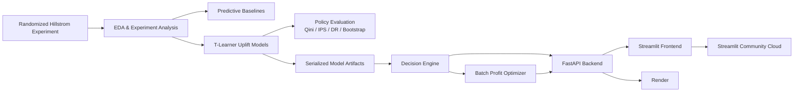

# Personalized Marketing Incrementality & Profit Optimization Platform

[](https://www.python.org/)
[](https://scikit-learn.org/)
[](https://fastapi.tiangolo.com/)
[](https://streamlit.io/)
[](https://www.docker.com/)

An end-to-end causal machine learning system that turns a randomized email experiment into personalized marketing decisions.

Instead of only asking **“Who is likely to buy?”**, this project asks the more useful business question:

> **Which action is most likely to create incremental customer value, and when is sending an email actually worth the cost?**

The platform combines randomized-experiment analysis, uplift modeling, treatment-policy evaluation, expected-revenue modeling, profit-aware decision rules, budget-constrained targeting, a FastAPI service, a Streamlit decision-support application, automated tests, Docker, and cloud deployment.

## Live Demo

- **Streamlit application:** https://marketing-incrementality-platform-9bnjubdtxc8wwq6oufdqnk.streamlit.app/
- **FastAPI backend:** https://marketing-incrementality-api.onrender.com
- **Interactive API docs:** https://marketing-incrementality-api.onrender.com/docs

> The Render free service may need a short cold start after inactivity.

---

## Business Problem

Traditional propensity models can rank customers by likelihood to convert, but they do not answer whether marketing **caused** the conversion.

A customer with a high purchase probability may have purchased anyway. Sending that customer an email can waste budget or reduce profit.

This project therefore models three possible actions:

- **No E-Mail**
- **Men's E-Mail**
- **Women's E-Mail**

and estimates how customer outcomes change under each action.

The final product supports two decision workflows:

1. **Single-customer recommendation** — compare predicted conversion, revenue, and profit under all three actions.
2. **Batch campaign optimization** — rank customers by incremental expected profit and target the strongest opportunities under either an email-capacity limit or a dollar budget.

---

## Dataset

The analysis uses the **Hillstrom / MineThatData randomized email marketing experiment**.

- **64,000 customers**
- Randomized into:
  - 21,306 No E-Mail
  - 21,307 Men's E-Mail
  - 21,387 Women's E-Mail
- Customer features include recency, historical spend, prior men's/women's purchases, geography, new-customer status, and shopping channel.
- Outcomes include visit, conversion, and spend.

Because treatment assignment was randomized, the experiment provides a strong foundation for estimating aggregate incremental effects.

---

## Experimental Findings

The Men's E-Mail treatment produced the strongest aggregate outcome in the randomized experiment.

| Treatment | Visit Rate | Conversion Rate | Avg. Spend / Customer |
|---|---:|---:|---:|
| No E-Mail | 10.62% | 0.57% | $0.65 |
| Men's E-Mail | 18.28% | 1.25% | $1.42 |
| Women's E-Mail | 15.14% | 0.88% | $1.08 |

Relative to No E-Mail:

- **Men's E-Mail**
  - Conversion lift: **+0.68 percentage points**
  - Spend lift: **+$0.77/customer**
  - Estimated incremental experimental revenue: **~$16.4K**
  - Spend-lift 95% CI: **[$0.49, $1.05]**
- **Women's E-Mail**
  - Conversion lift: **+0.31 percentage points**
  - Spend lift: **+$0.42/customer**
  - Estimated incremental experimental revenue: **~$9.1K**
  - Spend-lift 95% CI: **[$0.17, $0.68]**

Randomization-balance checks did not reveal meaningful pre-treatment imbalance in the tested customer features.

---

## Modeling Approach

### 1. Predictive Baselines

Traditional supervised-learning baselines were built first to show the difference between **propensity** and **incrementality**.

Models included:

- Logistic regression
- Random forest
- Calibration-aware evaluation
- ROC-AUC, PR-AUC, Brier score, precision, recall, and class-imbalance analysis

This stage demonstrated that predicting who converts is not enough to determine whom marketing should target.

### 2. Causal / Uplift Modeling

Treatment-specific logistic-regression models were trained using a **T-learner** design.

For a customer (x):

```text
Uplift_Mens(x) =
P(conversion | Mens Email, x)
-
P(conversion | No Email, x)

Uplift_Womens(x) =
P(conversion | Womens Email, x)
-
P(conversion | No Email, x)
```

The models generate counterfactual-style predictions under each available action and support treatment ranking.

Evaluation included:

- Uplift ranking
- Qini-style evaluation
- Common three-arm policy comparison
- Inverse Propensity Scoring (IPS)
- Doubly Robust (DR) policy evaluation
- Bootstrap confidence intervals
- Budget-constrained targeting analysis

### 3. Policy Evaluation

The project intentionally separates **model ranking quality** from **proof that a personalized policy is globally better**.

The randomized data showed Men's E-Mail was the strongest fixed policy overall. Personalized policies were promising as a ranking tool, especially under constrained targeting, but IPS/DR comparisons did **not** provide statistically conclusive evidence that the learned personalized policy outperformed the best fixed policy across the full population.

That distinction is important: this system is presented as **decision support**, not as certainty about an individual's causal response.

---

## Revenue and Profit Decision Engine

Predicted conversion probabilities are translated into expected spend:

```text
Expected Spend
=
Predicted Conversion Probability
×
Average Purchase Amount Given Purchase
```

The user can then provide business assumptions:

- Gross margin
- Cost per email

and the system estimates:

```text
Expected Profit(No Email)
=
Expected Spend(No Email) × Gross Margin

Expected Profit(Email)
=
Expected Spend(Email) × Gross Margin - Email Cost
```

These are **scenario-based expected profit estimates**, not observed accounting profit.

The platform can therefore recommend different actions depending on whether the business objective is:

- Maximum conversion probability
- Maximum expected revenue
- Maximum expected profit

---

## Batch Campaign Optimization

For a customer batch, the platform:

1. Scores each customer under No E-Mail, Men's E-Mail, and Women's E-Mail.
2. Selects the best available email treatment.
3. Calculates incremental expected profit versus sending no email.
4. Ranks customers by incremental expected profit.
5. Selects only profitable contacts under the chosen campaign constraint.

Supported constraints:

- **Maximum Emails** — cap the number of customers contacted.
- **Dollar Budget** — convert campaign budget and per-email cost into an affordable capacity.

The budget is treated as a **maximum**, not a spending target. If additional emails have negative predicted incremental profit, the optimizer leaves budget unused.

---

## System Architecture



### Deployed request flow

```text
User
  ↓
Streamlit UI
  ↓ HTTPS
FastAPI / Render
  ↓
Decision Engine + Serialized Models
  ↓
Conversion / Uplift / Revenue / Profit Predictions
  ↓
Recommendation or Campaign Optimization Result
```

---

## Product Features

### Single Customer Recommendation

Users provide a customer profile and business assumptions. The app returns:

- Predicted conversion probability under all three actions
- Estimated uplift versus No E-Mail
- Expected spend
- Expected profit
- Best action for conversion
- Best action for revenue
- Best action for profit

### Batch Campaign Optimizer

Users can upload a CSV and:

- Score many customers
- Rank by incremental expected profit
- Apply a maximum-email constraint
- Apply a total campaign-budget constraint
- Inspect campaign economics
- Download the optimized recommendations as CSV

---

## API

The production API is implemented with **FastAPI**.

| Method | Endpoint | Purpose |
|---|---|---|
| GET | `/` | Health check |
| POST | `/score-customer` | Score one customer under all actions |
| POST | `/optimize-campaign` | Optimize a batch under an email-capacity constraint |
| POST | `/optimize-campaign-budget` | Optimize a batch under a dollar-budget constraint |

Interactive Swagger documentation is available at:

https://marketing-incrementality-api.onrender.com/docs

---

## Repository Structure

```text
marketing-incrementality-platform/
├── api/
│   └── main.py
├── app/
│   └── dashboard.py
├── artifacts/
│   ├── control_conversion_model.joblib
│   ├── mens_conversion_model.joblib
│   ├── womens_conversion_model.joblib
│   └── purchase_value_summary.csv
├── data/
│   ├── raw/
│   └── processed/
├── notebooks/
│   ├── 01_data_understanding.ipynb
│   ├── 02_predictive_baseline.ipynb
│   └── 03_causal_uplift_modeling.ipynb
├── src/
│   ├── decision_engine.py
│   └── batch_optimizer.py
├── tests/
│   ├── test_api.py
│   ├── test_batch_optimizer.py
│   └── test_decision_engine.py
├── Dockerfile
├── requirements.txt
├── requirements-runtime.txt
└── README.md
```

Raw and processed datasets are intentionally excluded from Git history.

---

## Tech Stack

**Data & ML**

- Python
- pandas
- NumPy
- SciPy
- scikit-learn
- Jupyter

**Causal / Experimentation**

- Randomized controlled experiment analysis
- Treatment-effect / uplift modeling
- T-learners
- Qini-style evaluation
- Inverse Propensity Scoring
- Doubly Robust evaluation
- Bootstrap confidence intervals

**Application & MLOps**

- FastAPI
- Pydantic
- Streamlit
- joblib
- pytest
- Docker
- Render
- Streamlit Community Cloud
- Git / GitHub

---

## Local Setup

### 1. Clone the repository

```bash
git clone https://github.com/AmeyaAstro/marketing-incrementality-platform.git
cd marketing-incrementality-platform
```

### 2. Create a Python 3.11 environment

Example with Conda:

```bash
conda create -n marketing-incrementality-py311 python=3.11
conda activate marketing-incrementality-py311
```

### 3. Install dependencies

```bash
python -m pip install -r requirements.txt
```

### 4. Run the API

```bash
python -m uvicorn api.main:app --reload
```

Open:

- API health check: http://127.0.0.1:8000/
- Swagger docs: http://127.0.0.1:8000/docs

### 5. Run the Streamlit app

In a second terminal:

```bash
streamlit run app/dashboard.py
```

The frontend defaults to `http://127.0.0.1:8000` for the API.

To use another backend:

```bash
export API_URL="https://your-api-url.example.com"
streamlit run app/dashboard.py
```

---

## Docker

Build the API image:

```bash
docker build -t marketing-incrementality-api .
```

Run locally:

```bash
docker run --rm -p 8000:8000 marketing-incrementality-api
```

The container respects a cloud-provided `PORT` variable and falls back to port 8000 locally.

---

## Tests

The project includes automated tests covering:

- Decision-engine scoring
- Profit-aware recommendations
- Batch scoring
- Maximum-email optimization
- Dollar-budget optimization
- API endpoints and request/response behavior

Run:

```bash
python -m pytest -q
```

The latest verified local test run passed **22 tests**.

---

## Important Limitations

This project deliberately avoids presenting model outputs as stronger causal evidence than the data supports.

- Individual uplift values are **model-based estimates**, not directly observed individual treatment effects.
- The experiment supports strong **aggregate** treatment comparisons, but heterogeneous treatment-effect estimates are more uncertain.
- Personalized policy evaluation did not conclusively outperform the strongest fixed Men's E-Mail policy in IPS/DR bootstrap comparisons.
- Spend outcomes are sparse and noisy, which creates wide uncertainty for revenue-policy estimates.
- Expected profit uses user-supplied gross margin and email cost; it is a business scenario calculation rather than observed profit.
- The dollar-budget optimizer assumes a constant per-email cost, so the budget constraint reduces to an affordable contact capacity rather than a general knapsack problem.
- The current dataset does not support customers with neither historical men's nor women's product activity in the model feature space used by the production application.

A real production rollout should validate targeting policies through new randomized experiments before high-stakes deployment.

---

## What This Project Demonstrates

This project was designed to go beyond a notebook-only ML portfolio project. It demonstrates the ability to:

- Frame a business problem as a causal decision problem
- Analyze randomized experiments
- Distinguish propensity prediction from treatment effect
- Build and evaluate uplift models
- Quantify uncertainty instead of relying only on point estimates
- Translate model outputs into revenue and profit decisions
- Build batch optimization logic
- Serve models through a typed REST API
- Build an interactive decision-support product
- Write automated tests
- Containerize an ML service
- Deploy a working end-to-end application

---

## Author

**Ameya Joshi**  
M.S. Computer Science, UNC Charlotte

- GitHub: https://github.com/AmeyaAstro
- Live application: https://marketing-incrementality-platform-9bnjubdtxc8wwq6oufdqnk.streamlit.app/

